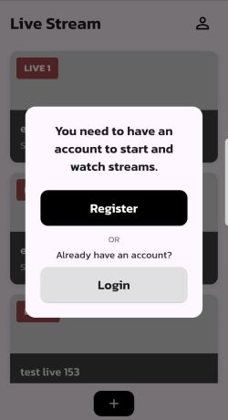
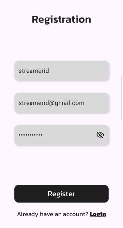
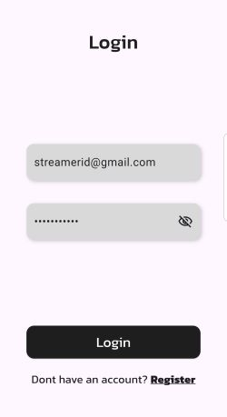
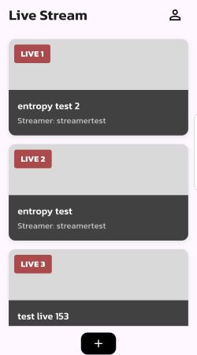
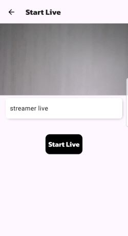
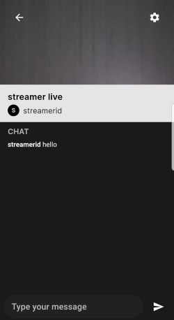
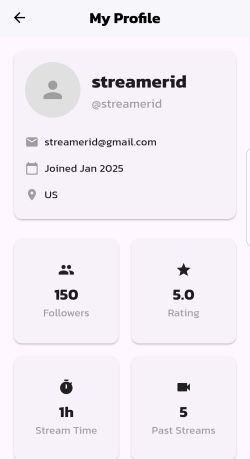
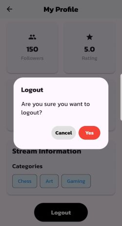

# End-to-End Encrypted Live Streaming Application

A mobile live streaming application with end-to-end encryption (E2EE) implemented using **Elliptic Curve Diffie-Hellman (ECDH) Curve25519** for key exchange and **AES-256-GCM** for video stream encryption. Built as an undergraduate thesis project in Informatics Engineering.

---

## Background

Most live streaming platforms transmit video data through servers without encrypting the content itself, meaning the server and potentially third parties can access the raw video stream. This application addresses that gap by implementing end-to-end encryption, ensuring that only the streamer and authorized viewers can access the video content. Even the streaming server (LiveKit) has no access to the decrypted data.

---

## Features

- End-to-end encrypted live streaming using AES-256-GCM
- ECDH Curve25519 key pair generation and secure public key exchange
- Encrypted private key storage on device using Flutter Secure Storage
- Public key and stream metadata management via Firebase Firestore
- Real-time video streaming via LiveKit
- In-stream chat between streamer and viewers
- User authentication with registration and login

---

## Tech Stack

| Layer | Technology |
|-------|------------|
| UI & Key Exchange Logic | Flutter (Dart) |
| Encryption / Decryption | Native Kotlin (Android) |
| Streaming Server | LiveKit (SFU) |
| Authentication & Database | Firebase (Auth + Firestore) |
| Secure Key Storage | Flutter Secure Storage |

---

## System Architecture

### User Roles
There are two main user roles: **Streamer** and **Viewer**, both connected directly to the application.

### High-Level Data Flow
1. Streamer initiates a streaming session
2. Video frames are captured, compressed, and encrypted on the streamer's device
3. Encrypted payload is sent to viewers via LiveKit as the transport layer
4. Viewer decrypts each received frame using the shared AES key
5. Decrypted frames are displayed in real-time on the viewer's screen

---

## E2EE Algorithm Flow

### 1. Key Generation (Registration)
- A cryptographically secure random number generator produces a **private key** valid for Curve25519
- The **public key** is derived via scalar multiplication: `public_key = private_key × G`
- Private key is stored **locally** on the device using Flutter Secure Storage and also stored in Firebase in **AES-256 encrypted form**
- Public key is stored in Firebase Firestore in plaintext for peer access during key exchange

### 2. AES Key Derivation (Session Start)
When a streaming session begins:
- Streamer uploads their public key to Firebase alongside stream metadata
- Viewer retrieves the streamer's public key and computes: `shared_secret = ECDH(viewer_private_key, streamer_public_key)`
- Simultaneously, viewer uploads their own public key to Firebase
- Streamer retrieves the viewer's public key and computes: `shared_secret = ECDH(streamer_private_key, viewer_public_key)`
- Both parties independently arrive at the **same shared secret** without ever transmitting their private keys
- The shared secret is hashed using **SHA-256** to produce a 256-bit **AES key**

### 3. Video Encryption (Streamer Side)
For every captured video frame:
1. Frame is captured from camera in YUV format via native Android module
2. Frame is converted and compressed to **JPG**
3. A unique **12-byte nonce (IV)** is generated per frame
4. **Additional Authenticated Data (AAD)** is constructed from `streamId + timestamp`
5. Frame is encrypted using **AES-256-GCM** with the AES key, nonce, and AAD
6. Final payload is assembled as: `[nonce(12)] + [ciphertext(+tag)] + [timestamp(4)] + [frameId(8)]`
7. Payload is sent to viewers via LiveKit video track

### 4. Video Decryption (Viewer Side)
For every received payload:
1. Payload components are separated: `nonce`, `ciphertext+tag`, `timestamp`, `frameId`
2. AAD is reconstructed from the same `streamId + timestamp`
3. Frame is decrypted using **AES-256-GCM** with the same AES key
4. If the **GCM authentication tag** is valid → frame is displayed
5. If verification fails → frame is discarded and the next frame is processed

---

## Application Flow

### Login Modal 

When opening the application for the first time, users are directed to the home page where they can start or watch a live stream. If the user is not authenticated, a pop-up is displayed prompting them to choose between registering a new account or logging in. The system then navigates to the corresponding page based on the user's selection.

### Registration 

User fills in name, email, and password. Upon successful registration, the system generates a key pair with the public key is stored in Firebase and the private key is stored both locally (via Flutter Secure Storage) and in Firebase in encrypted form.

### Login 

User enters email and password. Upon successful authentication, the system retrieves the encrypted private key from Firebase, decrypts it on-device, and verifies it against the locally stored private key to confirm key integrity.

### Home Page

Displays a list of currently active live streams with streamer name and stream title. Unauthenticated users are prompted to register or log in before joining or starting a stream.

### Start Live 

Streamer enters a stream title and starts the session. The app accesses the device camera and microphone, requests a JWT token from the LiveKit token server, and connects to the LiveKit server as a publisher.

### Watch Live 

Viewer selects a live stream, requests a JWT token with subscriber access, connects to LiveKit, and begins receiving encrypted video frames which are decrypted and displayed in real-time. In-stream chat is available for interaction.

### Profile

A personalized and easily accessible page where users can view and manage their account information, preferences, and activity. Also includes a logout button to sign out of the application.

### Logout Modal

A confirmation dialog displayed when the user initiates a logout, asking whether they are sure they want to sign out. The user can confirm by selecting Yes or cancel the action to remain logged in.

---

## Testing

### 1. Black-Box Testing
Functional testing of all application features to verify expected behavior across registration, login, streaming, and encryption flows.

### 2. Algorithm Validation
- Verified that ECDH Curve25519 successfully generates key pairs and stores them securely
- Verified that AES-256-GCM correctly encrypts on the streamer side and decrypts on the viewer side
- Confirmed that both parties independently derive identical AES keys from the ECDH key exchange

### 3. Encryption & Decryption Performance

Measured over a 60-second live streaming session. After outlier removal using the IQR method (1.5 factor), 1,432 valid samples were analyzed.

| Process | Samples | Avg Time (ms) | Std Dev (ms) | Coefficient of Variation |
|---------|---------|---------------|--------------|--------------------------|
| Encryption | 778 | 3.64 | 1.30 | 35.6% |
| Decryption | 654 | 5.09 | 2.54 | 49.9% |
| **Total per frame** | **1,432** | **8.73** | - | - |

Decryption is ~39% slower than encryption due to the additional GHASH authentication tag verification overhead inherent to GCM mode. The total cryptographic overhead of **8.73ms per frame** demonstrates that AES-256-GCM can be implemented efficiently for real-time live streaming with minimal latency impact.

### 4. Entropy Analysis

Shannon entropy was measured across 500 frames for both plaintext (non-E2EE) and ciphertext (E2EE) streams to evaluate the effectiveness of the encryption in randomizing video data.

| Dataset | Frames | Avg Entropy (bit/byte) | Std Dev (bit/byte) |
|---------|--------|------------------------|--------------------|
| Plaintext | 500 | 6.5185 | 0.4782 |
| Ciphertext | 500 | 7.9746 | 0.0022 |

The ciphertext entropy of **7.9746 bit/byte reaches 99.7% of the theoretical maximum** of 8.0 bit/byte, representing a 22.3% increase over plaintext. The near-zero standard deviation (0.0022) confirms consistently high randomness across all encrypted frames, validating the effectiveness of the E2EE implementation.

### 5. Tampering Attack Tests

Each attack type was tested 10 times against a 1024-byte frame encrypted with AES-256-GCM (12-byte nonce, 16-byte authentication tag).

| Attack Type | Test Cases | Detected | Detection Rate |
|-------------|------------|----------|----------------|
| Bitflip | 10 | 10 | 100% |
| Truncation | 10 | 10 | 100% |
| Injection | 10 | 10 | 100% |
| Authentication Tag Manipulation | 10 | 10 | 100% |
| **Total** | **40** | **40** | **100%** |

**Bitflip** : Random bit modifications at various byte positions were all detected, confirming that even a single-bit change triggers GCM authentication failure.

**Truncation** : End, beginning, and middle truncations (1–20 bytes removed) were all rejected, ensuring payload structural integrity.

**Injection** : Random byte injections at beginning, middle, and end positions (1–20 bytes added) were all detected, preventing stream hijacking attacks.

**Authentication Tag Manipulation** : Both partial bitflip and full replacement of the 16-byte GCM tag were detected in all cases, validating the cryptographic integrity mechanism.

### 6. Confidentiality Testing

Four access scenarios were tested to verify that only authorized parties with the correct key can access video content.

| Scenario | Method | Result |
|----------|--------|--------|
| Authorized user | Decrypt with correct key | SUCCESS: Valid frame decoded |
| Unauthorized user | Decrypt with wrong key | FAILED: AEADBadTagException |
| Network eavesdropper | No key available | FAILED: Decryption impossible |
| Server admin | Direct decode without decryption | FAILED: Invalid image data |

The LiveKit server was confirmed to function as a **zero-knowledge relay**, it forwards encrypted payloads without any ability to access the plaintext video content.

---

## Getting Started

### Prerequisites
- Flutter SDK
- Android Studio (for native Kotlin build)
- Firebase project (Auth + Firestore enabled)
- LiveKit server instance and API credentials

### Setup
1. Clone the repository
```bash
git clone https://github.com/nabilah-az-zahra/livestream_webrtc.git
cd livestream_webrtc
```

2. Install Flutter dependencies
```bash
flutter pub get
```

3. Configure Firebase by adding your `google-services.json` to `android/app/`

4. Create a .env file and add your LiveKit server URL and API credentials:
LIVEKIT_URL=your_livekit_server_url
LIVEKIT_API_KEY=your_api_key
LIVEKIT_API_SECRET=your_api_secret

5. Run the application
```bash
flutter run
```

---

## Security Considerations

- Private keys never leave the device in plaintext, they are encrypted with AES-256 before being backed up to Firebase
- The LiveKit server acts only as a transport relay (SFU) and has no access to decryption keys
- Nonce uniqueness per frame prevents IV reuse attacks
- AAD binding to `streamId + timestamp` ensures payload integrity and prevents replay or injection attacks